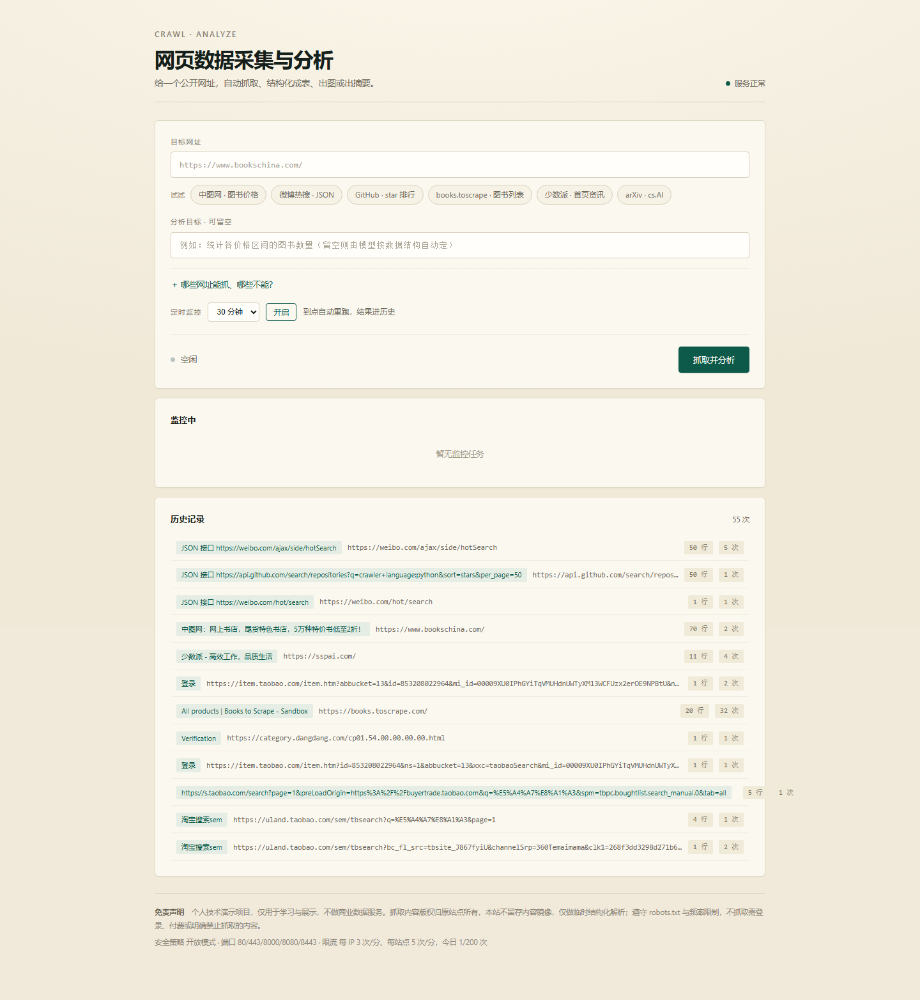

# 网页数据采集与分析系统 · Crawl Analyst

**English** · 中文（见下）

[](https://fsy357.github.io/crawl-analyst/)
[](https://github.com/fsy357/crawl-analyst)
[](LICENSE)

> Paste a public URL → Crawl4AI fetches it → the page is normalized into a table → LIDA generates charts, the LLM writes the summary. One page, async task queue, live SSE progress.

| | |
|---|---|
| **Stack** | Crawl4AI · LIDA · FastAPI · Celery + Redis · DuckDB · DeepSeek |
| **Pipeline** | crawl → structure → clean → store (DuckDB) → analyze (chart / summary) → SSE to UI |
| **Scope** | any public page or open JSON endpoint. Login-gated sites (Taobao / JD / Xiaohongshu) are out of scope by design — no cookie injection, no captcha bypass |
| **License** | MIT |

```bash
pip install -r requirements.txt && playwright install chromium
copy .env.example .env      # then fill LLM_API_KEY
start_all.cmd              # Redis :6380 + Celery + FastAPI :8000
```

---

输入一个公开网址，自动抓取、结构化成表，再出图表或文本摘要。抓取用 [Crawl4AI](https://github.com/unclecode/crawl4ai)，出图用 [LIDA](https://github.com/microsoft/lida)，调度用 Celery + Redis，界面是 FastAPI + 单页 HTML。



## 它做什么

一条流水线，三种入口，同一套输出：

```
网址 ──► 抓取（Crawl4AI / 直连 JSON 接口）
      ──► 结构化（分层适配器 + 规则兜底）
      ──► 落库（DuckDB）
      ──► 分析（LIDA 出图 / 大模型只写摘要）
      ──► 前端（图表 + 数据预览 + 历史 + 定时监控）
```

| 能力 | 说明 |
|---|---|
| 任意公开网址抓取 | 列表页、表格页、分类页、单篇文章都行 |
| JSON 接口直取 | 网址返回 JSON 时跳过浏览器渲染，直接转 DataFrame |
| 确定性清洗 | 价格/评分/评论/链接按规则抽，不靠大模型编事实 |
| 自动出图 | 留空目标则由模型按数据结构决定图表；也可手写目标 |
| 定时监控 | 每 5 分钟 / 30 分钟 / 1 小时自动重跑，留快照 |
| 异步不阻塞 | Celery + Redis，任务有阶段进度，SSE 实时回传 |

## 哪些网址能抓、哪些不能

| | 站点类型 | 结果 |
|---|---|---|
| ✅ | 不需要登录的公开页面（中图网、books.toscrape、少数派、arXiv） | 抽成表 + 出图 |
| ✅ | 公开 JSON 接口（微博热搜、GitHub 搜索） | 直接转表 + 出图 |
| ⚠️ | 单篇长文（无列表结构） | 只出正文摘要 + 段落统计 |
| ❌ | 淘宝 / 京东 / 拼多多 / 小红书 / 微博页面 | 要登录态与人机校验，只抓到空壳页 |

**为什么这类站抓不到**：它们对匿名请求返回 2000 字节左右的纯 JS 壳，可见文字为 0，内容要拿到登录后的 Cookie 才渲染。本项目不做 Cookie 注入、不打码、不伪造指纹——那是绕过站点安全机制，属于合规红线。合规路径只有官方开放平台 API。

### JSON 接口怎么用

网址里带 `/ajax/`、`/api/`，浏览器打开满屏是 `{ }` 的，就是接口。抓它比解析页面稳得多。

```
# 微博实时热搜（接口校验 Referer，代码里已自动带上同站点 Referer）
https://weibo.com/ajax/side/hotSearch

# GitHub 搜索（公开、无需鉴权）
https://api.github.com/search/repositories?q=crawler+language:python&sort=stars&per_page=50
```

自己找接口的方法：目标页面 → F12 → 网络 → 筛 Fetch/XHR → 找返回 JSON 的请求 → 标头里抄「请求 URL」。

## 架构

```
├─ src/
│  ├─ main.py          FastAPI 路由：提交任务 / 任务状态 / 页面详情 / 监控 / 历史
│  ├─ celery_worker.py Celery 任务定义（抓取 + 分析两阶段）
│  ├─ page_svc.py      抓取与结构化核心：适配器分层、清洗规则、空壳页识别
│  ├─ lida_svc.py      LIDA 封装：summarize → visualize，中文字体自动选
│  ├─ llm_svc.py       大模型：正文摘要、候选分析目标（只做语义，不造数据）
│  ├─ db.py            DuckDB 读写：pages / analyses / watch_state
│  ├─ monitor_svc.py   定时监控与快照
│  ├─ url_guard.py     URL 校验：协议、端口、重定向二次校验、私网拦截
│  ├─ rate_limit.py    限流：单 IP / 单站点 / 每日配额
│  ├─ auth.py          HTTP Basic 鉴权（可开关）
│  └─ static/index.html 单页前端（无框架）
└─ docs/
   ├─ 数据清洗规则.md   各适配器的字段与判据
   └─ 开发笔记.md       迭代记录与踩坑（体积较大，可跳过）
```

**适配器顺序**：`json_api → arxiv → dangdang → bookschina → table → items（重复块） → text_blocks（正文分块）`。前面命中就不往下走；每条分支都是"能抽到就抽，抽不到退回上一层"，所以遇到新站点不会直接崩。

## 快速开始（Windows）

```powershell
# 1. 依赖（命令都在仓库根目录执行）
python -m venv venv
venv\Scripts\pip install -r requirements.txt
venv\Scripts\playwright install chromium

# 2. 配置：复制 .env.example 为 .env，填 LLM_API_KEY
copy .env.example .env

# 3. 起三个进程（Redis 6+ / Celery / FastAPI）
redis-server --port 6380 --requirepass changeme
venv\Scripts\celery -A src.celery_worker worker --pool=solo -l info
venv\Scripts\uvicorn src.main:app --port 8000
```

打开 `http://127.0.0.1:8000/`。

**懒人版**：双击 `start_all.cmd`。脚本用 `%~dp0` 解析自身所在目录，**不写死任何绝对路径**；Redis 按 `REDIS_HOME` 环境变量 → 仓库内 `redis\` → `D:\Redis8` → PATH 的顺序自动找，找不到会打印手动启动命令。关闭用 `stop_all.cmd`。

| 可选环境变量 | 用途 |
|---|---|
| `REDIS_HOME` | redis-server.exe 所在目录 |
| `REDIS_PASSWORD` | Redis 密码，须与 `.env` 的 `REDIS_URL` 一致（默认 `changeme`） |
| `PLAYWRIGHT_BROWSERS_PATH` | 只在浏览器没装在默认位置时需要 |

仓库里如果有 `playwright_browsers/` 或 `crawl4ai_home/` 目录，脚本会自动把它们指过去，保证 Playwright 与 Crawl4AI 的缓存也都落在同一块盘。

**环境变量**（`.env`）：

| 键 | 作用 |
|---|---|
| `LLM_API_KEY` / `LLM_BASE_URL` / `LLM_MODEL` | 摘要与目标提议用的模型（默认 DeepSeek） |
| `REDIS_URL` | Celery broker，需 Redis ≥ 6 |
| `DUCKDB_PATH` | 结果库路径 |
| `PAGE_URL_POLICY` | `open` 任意公网网址 / `demo` 示例站 / `allowlist` 白名单 |
| `PUBLIC_AUTH` | `1` 开启 Basic 鉴权，`0` 关闭 |

`.env` 已在 `.gitignore` 里，不会进仓库。

## 技术细节

- **清洗规则确定性**：价格、评分、评论数、链接用正则与 class 命中抽取，模型只负责"这段正文讲什么"。同一页面重跑结果一致，不会出现数字被模型编出来。
- **空壳页识别**：同时命中 ≥2 个风控信号（`请登录`/`验证码`/`加载中`）或正文 < 1200 字符才判空壳，避免正文里出现 "robot" 就误判。
- **重复块打分**：`条数 × (0.45×标题比例 + 0.45×价格比例 + 0.1×图片比例)`，防止把导航菜单当商品卡。
- **LIDA 用法**：必须 `summarize` 再 `visualize`；中文标签靠 `fontManager` 挑中文字体（本机解析到 Microsoft YaHei）。
- **DuckDB**：读写共用同一个 `duckdb.connect()`，只读/读写混用会冲突。

## 合规

个人学习项目，不做商业数据服务。只抓公开内容，遵守 robots.txt 与站点频率限制，不抓需登录、付费或明确禁止抓取的内容，不留存内容镜像。`.env`、`data/`、`logs/`、`venv/` 均不入库。

## License

MIT

## 作者

[@fsy357](https://github.com/fsy357)
